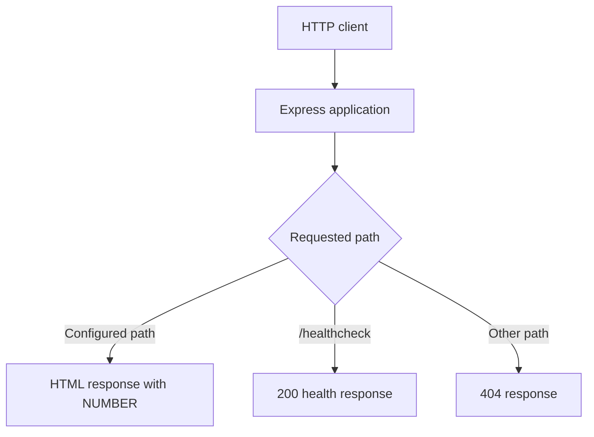

# Noderino – Environment-Configurable Node.js Service

A small Express application for practising environment-based configuration and basic HTTP service behaviour.

## What it demonstrates

- Configure the HTTP port with `PORT`.
- Configure the route served by the app with `DESIRED_PATH`.
- Pass a configurable value into the response with `NUMBER`.
- Expose a health endpoint at `/healthcheck`.
- Return a 404 response for unknown routes.
- Handle `SIGTERM` and `SIGINT` for graceful shutdown.

## Technology stack

- Node.js
- Express 5
- dotenv

## Request flow



## Run locally

Prerequisite: Node.js and npm.

```bash
npm install
npm start
```

The default configuration listens on port `8080` and serves the root path.

Open [http://localhost:8080](http://localhost:8080).

## Configure with environment variables

Linux / macOS:

```bash
PORT=3000 DESIRED_PATH=/demo NUMBER=42 npm start
```

Windows PowerShell:

```powershell
$env:PORT="3000"
$env:DESIRED_PATH="/demo"
$env:NUMBER="42"
npm start
```

Then open [http://localhost:3000/demo](http://localhost:3000/demo).

Health check:

```bash
curl -i http://localhost:3000/healthcheck
```

## Project structure

```text
.
├── index.js       # Express routes, configuration and shutdown handlers
├── package.json   # Dependencies and npm scripts
├── package-lock.json
└── README.md
```

## Test status

The current `npm test` script is a placeholder that prints a success message; it does not execute a real automated test suite yet. Add route and health-check tests before presenting test coverage as implemented.

## DevOps improvement ideas

- Add a Dockerfile and a non-root container user.
- Add real automated tests for the configured route, health endpoint and 404 response.
- Add a CI workflow to install dependencies and run tests.
- Add a container image vulnerability scan.
- Add Kubernetes readiness and liveness probes if deploying to a cluster.


## GitHub Actions and Azure deployment

The GitHub Actions workflow builds the Node.js application on pushes to `main`. Azure deployment is a separate manual action so a missing or expired Azure service-principal credential does not make normal code validation fail.

To deploy, open **Actions → Build and deploy Node.js app to Azure Web App - rahul-app → Run workflow** and select `deploy_to_azure=true`. The Azure client ID, tenant ID and subscription ID secrets must belong to the same valid Entra ID application and tenant. The current workflow run previously failed at Azure login with an application-not-found error; update those secrets in GitHub Settings before requesting deployment.
